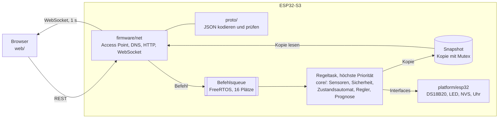

# Räucherofensteuerung (ESP32-S3)

Steuerungssoftware für einen Räucherofen auf einem ESP32-S3. Prüfungsleistung im IU-Modul „Projekt: Software Development“. Getestet wird mit DS18B20-Sensoren und einer LED statt Heizelement, ohne Netzspannung.

Stand: alle Meilensteine M0 bis M11 umgesetzt. Die Tests auf der echten Platine stehen noch aus (`docs/testbericht.md`).

## Was das System kann

- **Regelung:** PI-Regler mit Anti-Windup, Ausgang als langsame PWM mit 4 s Zykluszeit. Zustände `BEREIT`, `AUFHEIZEN`, `HALTEN`, `ABKUEHLEN`, `FEHLER`, `SICHERER_ZUSTAND` (`docs/zustandsautomat.md`). Nach jedem Neustart steht das System in `BEREIT` mit Ausgang 0.
- **Sicherheit:** Vor dem Regler prüft `core/safety` in jedem Zyklus: Lesefehler und fehlender Garraumsensor, Wert außerhalb des plausiblen Bereichs, eingefrorener Wert bei aktivem Ausgang, Übertemperatur über der festen Grenze von 120 °C und ein zu langer Regelzyklus. Beim Heizen führt jeder Fehler in den sicheren Zustand mit Ausgang 0, Übertemperatur auch ohne Start. Er bleibt, bis die Ursache weg ist und von Hand zurückgesetzt wird. Ohne Heizen sperrt ein Fehler nur den Start (`FEHLER`, E-020).
- **Sensoren:** bis zu 8 DS18B20 an einem 1-Wire-Bus, je mit Rolle (`Garraum`, `Kern 1`, `Kern 2`, `Generator`, `nicht zugeordnet`) und Kalibrieroffset. Neue Sensoren erscheinen als nicht zugeordnet. Die Zuordnung übersteht einen Neustart.
- **Fertigzeit-Prognose:** schätzt aus den Messwerten, wann ein Kernfühler sein Kernziel erreicht.
- **Netzwerk:** eigener Access Point mit WPA2, Captive Portal, REST-API und WebSocket mit Livewerten im Sekundentakt (`docs/api.yaml`).
- **Weboberfläche:** Status aller Sensoren und Rollen, Sollwert und Kernziel, Start, Stopp, Zurücksetzen des sicheren Zustands, Rollen und Offsets, Livekurve, Prognose. Für das Handy gebaut, gzip unter 80 KB.

## Architektur



- `core/` ist reines C11 ohne ESP- oder FreeRTOS-Header und ohne malloc nach der Initialisierung. Es spricht nur mit Interfaces in `core/include/` (Sensor, Ausgang, Uhr, Speicher, Log). Die Zeit wird immer injiziert.
- Auf dem Host ersetzt `platform/host/` die Treiber: Mocks, Fake-Uhr und ein Simulator des Ofens. So laufen dieselben core-Dateien in den Tests und in der Firmware.
- Befehle gehen nur über die Queue an den Regeltask. Er prüft jeden Befehl selbst und verwirft ungültige. Der Zustand geht nur als Kopie nach außen. Der Regeltask wartet weder auf die Queue noch auf den Mutex.
- `firmware/net` kennt weder Treiber noch core. CI prüft das über die Include-Regeln und über die Symbole im Firmware-Build.

| Ordner | Inhalt |
|---|---|
| `core/` | Interfaces, Sensorverwaltung, Sicherheitslogik, Zustandsautomat und Regler, Prognose |
| `proto/` | JSON-Kodierung von Befehlen und Zustand, Validierung |
| `platform/host/` | Mocks, Fake-Uhr, Simulator für die Host-Tests |
| `platform/esp32/` | Treiber für DS18B20, LED-Ausgang, NVS-Speicher, Uhr |
| `firmware/` | ESP-IDF-Projekt: `main/` mit Regeltask und Statuslog, `components/` mit Hüllen für die reinen Teile, Queue und Snapshot, `net/` mit Netzwerk |
| `web/` | Weboberfläche mit Preact, TypeScript und Vite |
| `test/` | Unity-Tests, Prüfskripte, Unity selbst unter `test/vendor/unity/` |
| `docs/` | Anforderungen, API, Entscheidungen, Zustandsautomat, Testbericht, Hardwaretest, KI-Log |

## Voraussetzungen (macOS)

Werkzeuge für den Host-Build und Node.js für die Weboberfläche (ab Version 24, in CI 24):

```bash
brew install cmake ninja cppcheck gcovr node
```

`python3` für die Prüfskripte ist auf macOS vorinstalliert. Für die Firmware kommt ESP-IDF v5.5.6 dazu, dieselbe Version wie in CI (E-031). Einmalig installieren, rund 2 GB:

```bash
git clone -b v5.5.6 --recursive https://github.com/espressif/esp-idf.git ~/esp/esp-idf
```

```bash
~/esp/esp-idf/install.sh esp32s3
```

## Host bauen und testen

```bash
cmake -S . -B build -G Ninja -DCMAKE_BUILD_TYPE=Debug
```

```bash
cmake --build build
```

```bash
ctest --test-dir build --output-on-failure
```

ctest führt 39 Einträge aus: die 19 Unity-Testprogramme, darunter die Integrationstests über mehrere simulierte Stunden, und die Prüfskripte für Include-Regeln, Symbole, Kconfig-Platzhalter, Größenbudget und den Abgleich der Anforderungen.

Statische Analyse mit cppcheck:

```bash
cmake --build build --target cppcheck
```

Abdeckung von `core/safety`, die bei Zeilen und Zweigen 100 Prozent sein muss, in einem eigenen Build-Ordner:

```bash
cmake -S . -B build-cov -G Ninja -DCMAKE_BUILD_TYPE=Debug -DROF_COVERAGE=ON
```

```bash
cmake --build build-cov --target coverage
```

Prüfung der API-Beschreibung:

```bash
npx --yes @redocly/cli@2.64.0 lint docs/api.yaml
```

Lokal misst Apples `gcov` (LLVM), in CI misst GCC; maßgeblich ist CI. Ebenso meldet das lokale cppcheck andere Dinge als die ältere Version in CI.

## Weboberfläche

Die Typen der API erzeugt `openapi-typescript` bei jedem Lauf aus `docs/api.yaml`.

```bash
npm --prefix web ci
```

```bash
npm --prefix web run lint
```

```bash
npm --prefix web run typecheck
```

```bash
npm --prefix web test
```

```bash
npm --prefix web run build
```

Größenbudget prüfen (dasselbe wie in CI):

```bash
python3 firmware/tools/gzip_web.py web/dist build/www_gzip --max-bytes 81920
```

`npm --prefix web run dev` startet einen Entwicklungsserver, der `/api` und `/ws` an das Gerät unter 192.168.4.1 weiterleitet, wenn der Rechner mit dessen WLAN verbunden ist. Wer Pakete hinzufügt oder ändert, nimmt `npx npm@11.19.1 install` (E-043).

## Firmware

### Konfigurieren

In jedem neuen Terminal zuerst die Umgebung von ESP-IDF laden:

```bash
. ~/esp/esp-idf/export.sh
```

Pins, WLAN-Name und WLAN-Passwort stehen im Menü „Raeucherofensteuerung“:

```bash
idf.py -C firmware menuconfig
```

| Einstellung | Standard |
|---|---|
| GPIO des 1-Wire-Busses | 4 |
| GPIO der LED | 5 |
| Name des WLANs | `Raeucherofen` |
| WLAN-Passwort, 8 bis 63 Zeichen | Platzhalter `bitte-aendern` |

Mit dem Platzhalter startet der Access Point nicht, die Regelung läuft dann ohne WLAN (E-041). Das eigene Passwort steht nur in `firmware/sdkconfig`. Diese Datei entsteht beim ersten Bauen aus `firmware/sdkconfig.defaults` und steht nicht im Repository. Nach einer Änderung an `sdkconfig.defaults` die Datei `firmware/sdkconfig` löschen, sonst gelten die alten Werte weiter.

Im Menü speichert die Taste S (mit Enter bestätigen), Q beendet. Nicht D drücken: „Save minimal config“ überschreibt `firmware/sdkconfig.defaults`, und das Passwort stünde dann in einer Datei des Repositorys. Ist das passiert, stellt `git restore -- firmware/sdkconfig.defaults` die Datei wieder her.

### Bauen

Zuerst die Weboberfläche bauen (`npm --prefix web run build`). Der Firmware-Build komprimiert `web/dist` mit gzip und schreibt es als LittleFS-Abbild in die Partition `www` (E-038). Fehlt `web/dist`, bricht er mit Hinweis ab.

```bash
idf.py -C firmware build
```

### Flashen und Monitor

Das Board über den USB-Anschluss mit der Aufschrift „UART“ anschließen, mit einem Kabel, das auch Daten überträgt. `ls /dev/cu.*` zeigt den Port. Auf dem Testboard sitzt hinter diesem Anschluss ein CH343; macOS bindet ihn ohne Treiber als `/dev/cu.usbmodem…` ein. Den Port mit `-p` angeben, sonst probiert `idf.py` alle seriellen Ports durch, auch die von Bluetooth-Geräten.

```bash
idf.py -C firmware -p /dev/cu.usbmodemXXXX flash monitor
```

- `monitor` braucht ein echtes Terminal und hält den Port offen, bis Ctrl+] ihn beendet. Solange er läuft, scheitert jedes weitere Flashen mit „port is busy“.
- Über den Anschluss „UART“ schaltet `idf.py` den Chip selbst in den Download-Modus. Am Anschluss „USB“ gelingt das nicht, solange dort eine fremde Firmware läuft, etwa die des Händlers. Dann von Hand: BOOT halten, RESET kurz drücken, BOOT loslassen. Der Port bekommt dabei einen anderen Namen.

Alle 5 s schreibt die Firmware ein Statuslog: Zustand, Sollwert, Tastgrad, aktive und verriegelte Ursache, jeden Sensor mit Rolle und Wert, Kernziel und Prognose sowie die Laufzeit des Regeltasks.

## Hardware aufbauen

Nur Kleinspannung über USB, keine Netzspannung.

| Bauteil | Anzahl |
|---|---|
| ESP32-S3-DevKitC-1 N16R8 | 1 |
| DS18B20, z. B. wasserdicht mit Kabel | 1 bis 8, für alle Rollen 4 |
| Widerstand 4,7 kΩ (Pull-up für den 1-Wire-Bus) | 1 |
| LED und Widerstand 330 Ω | je 1 |
| Steckbrett, Steckbrücken, USB-Kabel | |

Verdrahtung:

- Alle DS18B20 parallel: VDD an 3,3 V, GND an GND, Daten an GPIO 4. Der Pull-up von 4,7 kΩ liegt einmal zwischen Daten und 3,3 V. Parasitäre Speisung wird nicht unterstützt (E-032).
- LED mit Vorwiderstand zwischen GPIO 5 und GND. Die eingebaute RGB-LED des Boards eignet sich nicht (E-034).

Die Prüfschritte auf der Platine stehen in `docs/hardwaretest.md`.

## Bedienung

1. Mit dem WLAN „Raeucherofen“ verbinden. Die Oberfläche öffnet sich meist von selbst als Anmeldeseite, sonst `http://192.168.4.1/` öffnen.
2. Unter „Sensoren“ einem Sensor die Rolle Garraum geben. Ohne Garraum steht das System in `FEHLER` und lässt sich nicht starten. Kernfühler bekommen die Rolle Kern 1 oder Kern 2.
3. Sollwert eingeben und setzen. Werte außerhalb der Grenzen werden abgelehnt, nicht begrenzt, und die Seite nennt den Grund.
4. Optional ein Kernziel setzen. Es wirkt nicht auf die Heizung, nur auf die Prognose. Sie erscheint in `HALTEN` nach 5 Minuten Lernzeit als „noch ca. … min“.
5. Start. Der Ofen heizt auf (`AUFHEIZEN`) und hält dann den Sollwert (`HALTEN`). Beim Testaufbau zeigt die LED den Ausgang: an, aus oder im Takt von 4 s.
6. Stopp beendet das Heizen (`ABKUEHLEN`, danach `BEREIT`).
7. Im sicheren Zustand zeigt die Seite die Ursache. Erst wenn sie behoben ist, wirkt „Sicheren Zustand zurücksetzen“. Danach steht das System in `BEREIT` und heizt erst nach einem neuen Start.

Rollen und Offsets lassen sich nur ändern, solange nicht geheizt wird. Bei Verbindungsverlust zeigt die Seite einen Hinweis und verbindet sich selbst neu. Dieselben Befehle gehen auch ohne Oberfläche über die REST-API, Beispiele in `docs/hardwaretest.md`.

## CI

GitHub Actions (`.github/workflows/ci.yml`) läuft bei jedem Push mit drei Jobs:

| Job | Schritte |
|---|---|
| `host` | CMake-Build, ctest, cppcheck, Zweigabdeckung von `core/safety`, Redocly |
| `web` | `npm ci`, Lint, Typprüfung, Vitest, Build, Größenbudget |
| `firmware` | nach `web`: `idf.py build` im Container `espressif/idf:v5.5.6` mit der gebauten Oberfläche, Symbolprüfung von `firmware/net` |

Ergebnisse und Zahlen stehen in `docs/testbericht.md`.

## Dokumentation

- `docs/anforderungen.md`: alle Anforderungen mit ID, Status und Nachweis
- `docs/testbericht.md`: Teststufen, Ergebnisse, gefundene Fehler, bekannte Grenzen
- `docs/hardwaretest.md`: Aufbau und Prüfschritte auf der Platine, Rauchtest im Emulator
- `docs/entscheidungen.md`: Entscheidungen mit verworfenen Alternativen
- `docs/zustandsautomat.md`: Zustände und Übergänge
- `docs/api.yaml`: OpenAPI-Beschreibung der Schnittstelle, Beispiel für den Zustand in `docs/api-examples/state.json`
- `docs/glossar.md`: deutsche Fachbegriffe und ihre englischen Namen im Code
- `docs/ki_log.md`: Kennzeichnung der KI-Nutzung

## KI-Nutzung

Teile des Projekts sind mit Claude Code (Anthropic) entstanden. Die Vorgaben dafür stehen in `CLAUDE.md`. Was je Meilenstein erzeugt, geändert oder abgelehnt wurde, steht in `docs/ki_log.md`.
