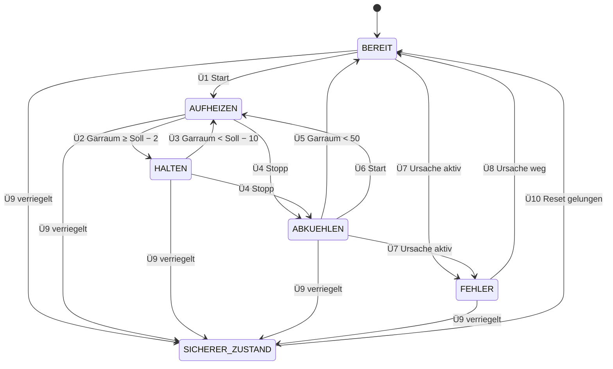

# Zustandsautomat

Umsetzung: `core/include/rof_state_machine.h`, `core/control/rof_state_machine.c`
Tests: `test/test_state_machine.c` (CTL-04, CTL-05, SAF-10)

## Zustände

| Zustand | Code | Ausgang | Rollen zuweisen | Bedeutung |
|---|---|---|---|---|
| BEREIT | `ROF_STATE_IDLE` | aus | ja | Startzustand nach jedem Neustart (SAF-10), wartet auf Start |
| AUFHEIZEN | `ROF_STATE_HEATING` | Regler | nein | Garraum wird auf den Sollwert gebracht |
| HALTEN | `ROF_STATE_HOLDING` | Regler | nein | Garraum ist am Sollwert und wird gehalten |
| ABKUEHLEN | `ROF_STATE_COOLING` | aus | ja | nach Stopp, bis der Garraum abgekühlt ist |
| FEHLER | `ROF_STATE_FAULT` | aus | ja | Fehler ohne Heizen, Start gesperrt, endet von selbst (E-020) |
| SICHERER_ZUSTAND | `ROF_STATE_SAFE_STATE` | aus | ja | Sicherheitslogik hat verriegelt, endet nur über Reset (SAF-02) |

Nach `rof_fsm_init()` ist der Automat immer in BEREIT, ohne Sollwert, mit Ausgang aus (SAF-10). Geheizt wird erst nach einem neuen Start. Tests: `test_starts_idle_with_output_off_and_no_setpoint`, `test_default_config_has_agreed_values`, `test_init_rejects_missing_logger_and_bad_config`.

## Übergänge

Je Regelzyklus prüft `rof_fsm_step()` in dieser Reihenfolge: verriegelt, dann aktiv, dann Normalbetrieb. So gewinnt immer der strengere Zustand. Befehle (Start, Stopp) wirken sofort.

Standardwerte (E-021): Halteband 2 °C, Rückkehrband 10 °C, abgekühlt unter 50 °C.

| Nr. | Von | Auslöser | Nach | Tests |
|---|---|---|---|---|
| Ü1 | BEREIT | Start, Sollwert gesetzt | AUFHEIZEN | `test_u1_start_in_idle_begins_heating` |
| Ü2 | AUFHEIZEN | Garraum ≥ Sollwert − 2 °C | HALTEN | `test_u2_heating_reaches_hold_band` |
| Ü3 | HALTEN | Garraum < Sollwert − 10 °C (Tür offen, Sollwert erhöht) | AUFHEIZEN | `test_u3_holding_falls_below_reheat_band`, `test_u3_raised_setpoint_returns_to_heating` |
| Ü4 | AUFHEIZEN, HALTEN | Stopp | ABKUEHLEN | `test_u4_stop_while_heating_cools_down`, `test_u4_stop_while_holding_cools_down` |
| Ü5 | ABKUEHLEN | Garraum < 50 °C | BEREIT | `test_u5_cooled_down_is_idle` |
| Ü6 | ABKUEHLEN | Start | AUFHEIZEN | `test_u6_start_while_cooling_heats_again` |
| Ü7 | BEREIT, ABKUEHLEN | Ursache aktiv, nicht verriegelt | FEHLER | `test_u7_fault_in_idle_blocks_start`, `test_u7_fault_while_cooling` |
| Ü7 | AUFHEIZEN, HALTEN (Absicherung) | Ursache aktiv, nicht verriegelt | FEHLER | `test_u7_unlatched_fault_while_heating_stops_heating`, `test_u7_unlatched_fault_while_holding_stops_heating` |
| Ü7 | SICHERER_ZUSTAND | Reset gelungen, Ursache sofort wieder aktiv | FEHLER | `test_u7_cause_returning_after_reset_is_a_fault` |
| Ü8 | FEHLER | keine Ursache mehr aktiv | BEREIT | `test_u8_fault_clears_to_idle` |
| Ü9 | BEREIT | Sicherheitslogik verriegelt (nur Übertemperatur) | SICHERER_ZUSTAND | `test_u9_latch_in_idle_enters_safe_state` |
| Ü9 | AUFHEIZEN | Sicherheitslogik verriegelt | SICHERER_ZUSTAND | `test_u9_latch_while_heating_enters_safe_state` |
| Ü9 | HALTEN | Sicherheitslogik verriegelt | SICHERER_ZUSTAND | `test_u9_latch_while_holding_enters_safe_state` |
| Ü9 | ABKUEHLEN | Sicherheitslogik verriegelt (nur Übertemperatur) | SICHERER_ZUSTAND | `test_u9_latch_while_cooling_enters_safe_state` |
| Ü9 | FEHLER | Sicherheitslogik verriegelt (nur Übertemperatur) | SICHERER_ZUSTAND | `test_u9_latch_in_fault_enters_safe_state` |
| Ü10 | SICHERER_ZUSTAND | Verriegelung aufgehoben (Reset gelungen) | BEREIT | `test_u10_successful_reset_returns_to_idle` |

Ohne Heizen verriegelt die Sicherheitslogik nur bei Übertemperatur (E-020). Deshalb führen in BEREIT, ABKUEHLEN und FEHLER nur Übertemperaturen zu Ü9.

Gegenproben, bei denen kein Übergang stattfinden darf:

| Situation | bleibt | Test |
|---|---|---|
| AUFHEIZEN, Garraum knapp unter Sollwert − 2 °C | AUFHEIZEN | `test_heating_stays_below_hold_band` |
| HALTEN, Garraum genau Sollwert − 10 °C | HALTEN | `test_holding_stays_at_reheat_band` |
| ABKUEHLEN, Garraum genau 50 °C | ABKUEHLEN | `test_cooling_stays_at_threshold` |
| BEREIT ohne Befehl | BEREIT | `test_idle_stays_idle_without_command` |
| FEHLER, Ursache weiter aktiv | FEHLER | `test_fault_stays_while_cause_is_active` |
| SICHERER_ZUSTAND, Ursache weg, aber nicht zurückgesetzt | SICHERER_ZUSTAND | `test_safe_state_stays_while_latched` |

## Befehle

Ein abgelehnter Befehl ändert den Zustand nicht und meldet den Grund (`rof_cmd_result_t`, E-022).

| Befehl | BEREIT | AUFHEIZEN, HALTEN | ABKUEHLEN | FEHLER | SICHERER_ZUSTAND |
|---|---|---|---|---|---|
| Sollwert | prüfen, speichern | prüfen, speichern | prüfen, speichern | prüfen, speichern | prüfen, speichern |
| Start | Ü1, ohne Sollwert `NO_SETPOINT` | `ALREADY_RUNNING` | Ü6, ohne Sollwert `NO_SETPOINT` | `FAULT_ACTIVE` | `SAFE_STATE` |
| Stopp | nichts, OK | Ü4 | nichts, OK | nichts, OK | nichts, OK |
| Rolle zuweisen | erlaubt | gesperrt | erlaubt | erlaubt | erlaubt |
| Reset | Sache des Regelzyklus über `rof_safety_reset()`, danach Ü10 | | | | |

Ein ungültiger Sollwert wird mit `SETPOINT_TOO_LOW`, `SETPOINT_TOO_HIGH` oder `SETPOINT_NOT_A_NUMBER` abgelehnt (SAF-09); der alte Sollwert bleibt. Tests: `test_valid_setpoint_is_stored`, `test_invalid_setpoint_is_rejected_with_reason`, `test_start_without_setpoint_is_rejected`, `test_start_while_heating_is_rejected`, `test_start_in_safe_state_is_rejected`, `test_stop_in_idle_does_nothing`, `test_stop_in_fault_does_nothing`, `test_stop_in_safe_state_does_nothing`, `test_output_and_roles_per_state`.

## Diagramm

Die Absicherungsübergänge aus AUFHEIZEN, HALTEN und SICHERER_ZUSTAND nach FEHLER (Ü7) fehlen im Diagramm der Übersicht halber; sie stehen in der Tabelle.
